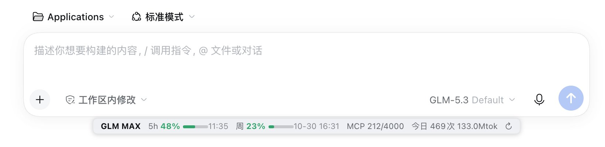

# dsh-glm-balance

在 [DeepSeek Harness (DSH)](https://deepseek.com) 对话输入框下方常驻显示 **智谱 GLM Coding Plan 套餐余量**，并提供 `glm_balance` 会话查询工具。

```
GLM MAX  5h 17% ▓░ 11:39   周 78% ▓▓ 10-26 08:30   MCP 127/4000   今日 389次 45.5Mtok  ↻
```



## 功能

- **每 5 小时 / 每周额度**：已用百分比、迷你进度条（绿→黄→红）、重置时间
- **MCP / 工具调用**：调用池用量与重置时间（悬停看 search-prime / web-reader / zread 明细）
- **今日用量**：当天模型调用次数与 token 消耗
- **↻ 手动刷新**：点击绕过缓存立即查询；平时自动轮询（默认 5 分钟，可配置）
- **`glm_balance` 工具**：在会话里直接问「查一下 GLM 余额」，返回详细文本报告
- **主题自适应**：使用 DSH 主题令牌，浅色 / 深色模式自动切换，半透明毛玻璃风格

## 安装

要求：DSH Desktop（macOS / Windows），且已配置 GLM Coding Plan 的 API Key
（即 provider 的 `apiKeyEnv` 指向的凭据引用，默认名 `ZAI_CODING_CN_API_KEY`，
密钥存放在 DSH 凭据库 `~/.dsh/.credentials.yaml`，插件不落盘、不上传）。

方式一（推荐）：本仓库 Release 下载 `glm-balance-<version>.tgz`，然后在 DSH
插件管理中从本地安装该压缩包。

方式二（开发者）：克隆仓库后用 DSH 的插件安装能力指向本目录：

```bash
git clone https://github.com/fengyuan/dsh-glm-balance.git
# 在 DSH 插件管理 / plugin_manager 中 install_bundle 指向该目录或打包后的 tgz
```

安装后**重启一次 DSH Desktop** 生效。

> 已知怪癖：通过 pnpm 安装 tgz 后 `locale/` 目录可能被扁平化到包根，
> 若插件标题显示异常，手动执行
> `mkdir -p node_modules/@local/glm-balance/locale && mv node_modules/@local/glm-balance/*.json node_modules/@local/glm-balance/locale/` 即可。

## 配置

在安装插件的 patch（或插件管理界面的配置项）中可覆盖：

| 键 | 默认值 | 说明 |
|---|---|---|
| `apiKeyRef` | `ZAI_CODING_CN_API_KEY` | 凭据引用名（只存引用名，不存 Key） |
| `baseURL` | `https://open.bigmodel.cn` | Z.ai 国际版账号改为 `https://api.z.ai` |
| `pollSeconds` | `300` | 状态栏自动刷新间隔（秒，30–3600） |
| `cacheTtlSeconds` | `60` | Host 端结果缓存时长（秒，5–600），手动刷新绕过 |

## 工作原理

- 数据来自智谱官方控制台在用的监控接口（非公开文档）：
  `GET {baseURL}/api/monitor/usage/quota/limit` 与 `/api/monitor/usage/model-usage`。
- Host 端注册同源路由 `/api/glm-balance/quota`（带缓存）并通过 `webServer.tapIndex`
  把状态栏脚本注入页面；注册 `glm_balance` 工具供模型调用。
- 密钥只存在于 Host 进程内，绝不出现在配置、日志或前端。

## 免责声明

监控接口未收录于公开 API 文档，字段与可用性可能随智谱调整而变化。
本插件与智谱 / Z.ai 无隶属关系，请合理控制查询频率（默认每 5 分钟一次 + 60 秒缓存）。

## License

[MIT](LICENSE)
